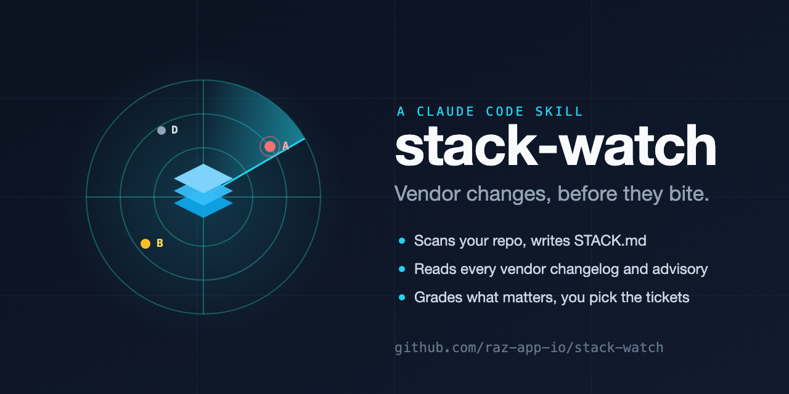

# stack-watch



A Claude skill that keeps you ahead of vendor changes: deprecations, sunsets, breaking API and SDK changes, pricing and limit changes, security advisories, and new features worth adopting.

Vendors announce these in changelogs nobody reads. stack-watch reads them for you, filters them down to what touches *your* stack, and proposes tickets. You pick which ones get created.

## What it does

A worked example of every step below is in [samples/README.md](samples/README.md).

1. **Discovers your stack.** A deterministic scanner reads `package.json`, your lockfile (npm, pnpm, Yarn, bun), hosting and framework config, layout files for third-party script tags, and env var *names* (never values). A renderer writes a `STACK.md` at your repo root that every contributor can read and correct.
2. **Detects drift.** Each run rescans, diffs against `STACK.md`, applies the changes, and summarizes git activity on dependency and config files since the last scan. A new package, a version bump, or a removed service from another contributor shows up in the report. Rows that disappear are flagged once and removed on the second consecutive miss.
3. **Probes vendor sources.** A fetcher reads every RSS and Atom feed and GitHub releases source for the vendors in your stack. Advisories come from OSV.dev for every locked version (no package manager needed); end-of-life dates from endoflife.date; deprecated or outdated pins from the npm registry. HTML-only changelogs are read by Claude directly.
4. **Classifies, maps impact, and grades.** Each item is rated Security, Breaking, Deprecation, Pricing or limits, Opportunity, or Noise, and mapped to the files and routes it affects. Then `rank.py` scores it (severity, impact, exposure, urgency, effort) and grades it A to D, so a Critical RCE with a fix available outranks a favorable pricing change even when both are "worth knowing". A ledger remembers everything it has already shown you, so nothing is reported twice.
5. **Proposes tickets and waits for you.** You get a sorted table with a grade, a score, and a suggested default per row. Reply with item numbers to ticket, `W3` to watch, `D4` to dismiss, or `defaults`. Tickets go to Asana, Linear, GitHub Issues, or a markdown file in the repo.

## Install

### Claude Code (plugin)

```
/plugin marketplace add raz-app-io/stack-watch
/plugin install stack-watch@stack-watch
```

This adds the skill and a `/stack-watch` command.

### Claude Code (skill folder)

Copy the skill into your personal or project skills directory:

```bash
git clone https://github.com/raz-app-io/stack-watch.git
cp -R stack-watch/skills/stack-watch ~/.claude/skills/
```

Use `.claude/skills/` inside a project instead to scope it to that project.

### Claude.ai and Claude Desktop

Zip the skill folder and upload it under Settings, Capabilities, Skills:

```bash
cd stack-watch/skills && zip -r stack-watch.zip stack-watch
```

## Usage

In a JavaScript or TypeScript repo:

```
/stack-watch                 # bootstrap if there is no STACK.md, otherwise probe
/stack-watch bootstrap       # rebuild STACK.md (the hand-confirmed section is kept)
/stack-watch probe ../other  # probe a different repo
```

Or just ask: "Check for vendor updates that affect this project", "What changed at Vercel or Next.js lately that matters to us?", "Refresh STACK.md".

The first run is a **bootstrap**: it builds `STACK.md` and `stack-watch/sources.json`, then stops for you to confirm them and fill in the hand-confirmed section (services the scan can't see, such as DNS, email, or analytics accounts). Every later run is a **probe**.

**Want to see it before running it?** [samples/README.md](samples/README.md) walks through one complete run: the generated STACK.md, the vendor sources, the report with its proposal table, the tickets, and the ledger. The input project is [examples/sample-next-app](examples/sample-next-app).

## Scheduled probes without Claude

[skills/stack-watch/assets/stack-watch.yml](skills/stack-watch/assets/stack-watch.yml) is a GitHub Actions workflow. Copy it to `.github/workflows/` after your first bootstrap. Every Monday it runs the deterministic half of a probe (`headless.py`: scan, drift, feeds, advisories, lifecycle, ledger dedupe) and, only when something is new, opens an issue labeled `stack-watch` with a digest. You then run `/stack-watch` to classify and ticket. The job never writes into your repo.

## Files it writes in your repo

| Path | Purpose |
|---|---|
| `STACK.md` | Human-readable stack reference. The "Hand-confirmed external services" section is yours; the skill never edits it. |
| `stack-watch/config.json` | Ticket tracker settings. |
| `stack-watch/sources.json` | Vendor to changelog URL map. Edit it to fix or add sources. |
| `stack-watch/ledger.json` | Every item ever seen, your decision on it, and run history. |
| `stack-watch/reports/YYYY-MM-DD.md` | One report per run. |
| `stack-watch/tickets.md` | Ticket table, only when using the markdown tracker. |

Commit them. They're meant to be shared with everyone who works on the repo.

## Configure a ticket tracker

`stack-watch/config.json`:

```json
{
  "tracker": {
    "type": "github",
    "project": "your-org/your-repo"
  }
}
```

| `type` | `project` | Needs |
|---|---|---|
| `markdown` (default) | ignored | nothing; tickets are rows in a table in `stack-watch/tickets.md` ([sample](samples/tickets.md)) |
| `asana` | Asana project name | Asana MCP connector |
| `linear` | team name, or `Team/Project` | Linear MCP connector |
| `github` | `owner/repo` | `gh` CLI or GitHub MCP connector |

Breaking, Deprecation, and Security items create a linked pair: a `RISK:` ticket describing the exposure and a work ticket describing the fix. See [ticket-conventions.md](skills/stack-watch/references/ticket-conventions.md).

## Design rules

- **Manual trigger only.** stack-watch never schedules itself.
- **Nothing is ticketed without your selection.**
- **Env values are never read.** The scanner never opens `.env`, `.env.local`, or any non-example env file. This is covered by a test.
- **Only what's in the stack is tracked.** A vendor gets probed only if the scan finds it or you list it in the hand-confirmed section.
- **STACK.md is a hypothesis, not the truth.** Every run rescans. A row that disappears is flagged once, then removed on the second consecutive miss.
- **Scripts do the deterministic work.** Scanning, rendering, diffing, fetching, auditing, and dedupe are Python with no dependencies and are unit tested. Claude's judgment is spent on reading HTML-only sources, classifying severity, and mapping impact.

## Security

stack-watch reads untrusted input by design, so the fetchers are guarded: http(s) only, no credentials in URLs, no private or link-local addresses unless you pass `--allow-private-hosts`, response sizes capped, redirects policed hop by hop with the GitHub token dropped if one leaves `api.github.com`. The headless job never runs your package manager (OSV.dev only) and neutralizes mentions and Markdown in vendor text before it reaches an issue. The scheduled workflow template pins stack-watch to a release tag and its actions to commit SHAs. Details and how to report a problem: [SECURITY.md](SECURITY.md).

## Limitations

- **JavaScript and TypeScript projects only** (npm, pnpm, Yarn, and bun). Python, Go, Ruby, and other ecosystems are not scanned yet. Monorepos are scanned at the root `package.json` only. Bun's binary `bun.lockb` yields declared ranges, not locked versions; the text `bun.lock` is fully supported.
- **Public web sources only.** Vendors that announce sunsets only by email are not covered. Every report repeats this.
- **Changelog quality varies.** Some vendors have no feed, and some change behavior without announcing it. Sources not in the built-in list are marked `unverified` until you confirm them.
- **Lifecycle coverage.** endoflife.date tracks most runtimes and frameworks but not every library (TypeScript, Drizzle, Prisma are missing), so EOL items appear only for products it lists.
- **GitHub API rate limit.** Release feeds are read through the GitHub API (60 requests an hour unauthenticated). Set `GITHUB_TOKEN` if you track many GitHub-hosted projects; the fetcher falls back to the public Atom feed when the API refuses.

## Built-in vendor sources

Vercel, Netlify, Cloudflare, Next.js, React, Astro, Node.js, TypeScript, Tailwind CSS, Neon, Supabase, PlanetScale, Upstash, Drizzle ORM, Prisma, Firebase, Clerk, Auth.js, Auth0, Stripe, Resend, Google Analytics, Google Search Console, Sentry, PostHog, and Calendly, every URL fetched and checked. Any other npm dependency gets a source automatically: `discover_sources.py` reads its registry record for the GitHub repository (releases feed) and homepage (changelog feed autodiscovery). Advisories, end-of-life dates, and deprecations come from OSV.dev, endoflife.date, and the npm registry.

### Adding a vendor

Pull requests to [vendor-sources.md](skills/stack-watch/references/vendor-sources.md) are welcome. For each source: fetch the URL yourself and confirm it returns the changelog (for a feed, that the response starts with `<rss` or `<feed`); prefer the vendor's own domain; prefer a feed over an HTML page; record the date you checked in the entry. If the vendor's feed mixes a blog with its changelog, note the `url_filter` that separates them. A GitHub releases page counts as a feed.

## Repository layout

```
.claude-plugin/          plugin and marketplace manifests
commands/stack-watch.md  the /stack-watch command
skills/stack-watch/
  SKILL.md               the skill instructions Claude follows
  references/            STACK.md template, vendor sources, severity rubric, ticket conventions
  assets/                report and tickets.md templates
  scripts/               scan_repo, render_stack, diff_stack, fetch_sources, audit, lifecycle,
                         discover_sources, rank, ledger, headless
examples/sample-next-app a small Next.js project the samples and tests run against
samples/                 one complete run's output (STACK.md, sources, report, tickets, ledger) with a walkthrough
tests/                   unit tests for the scripts (Python 3.9+, standard library only)
```

## Development

```bash
python3 -m unittest discover -s tests -v
```

The scripts can be run directly. Against the sample project:

```bash
python3 examples/sample-next-app/generate-lockfile.py   # the sample's lockfile is generated, not committed
python3 skills/stack-watch/scripts/scan_repo.py examples/sample-next-app --pretty > /tmp/scan.json
python3 skills/stack-watch/scripts/diff_stack.py /tmp/scan.json samples/STACK.md --pretty
python3 skills/stack-watch/scripts/fetch_sources.py samples/sources.json --since 2026-10-01 --pretty
python3 skills/stack-watch/scripts/audit.py examples/sample-next-app --pretty          # OSV.dev, no npm needed
python3 skills/stack-watch/scripts/lifecycle.py /tmp/scan.json --pretty
python3 skills/stack-watch/scripts/discover_sources.py /tmp/scan.json --existing samples/sources.json --pretty
python3 skills/stack-watch/scripts/rank.py samples/proposals.json --format md               # the graded table
```

Each script's docstring documents its arguments and output.

## License

[MIT](LICENSE)
